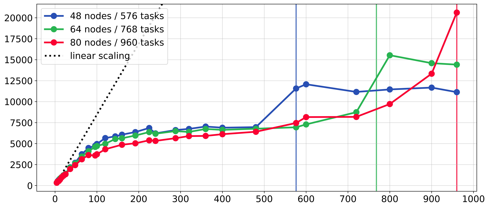
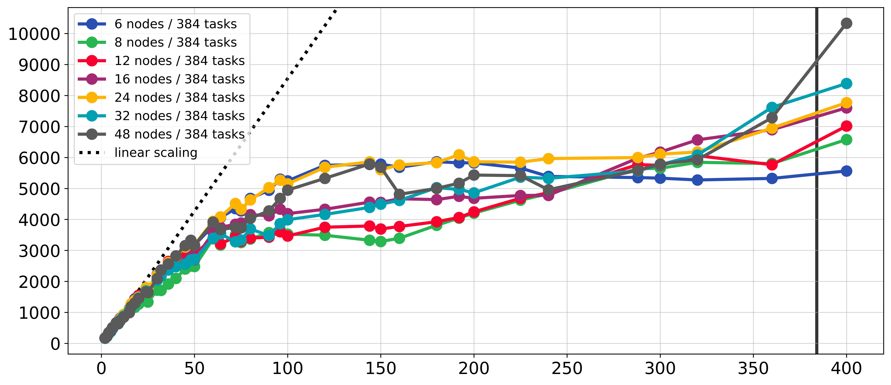
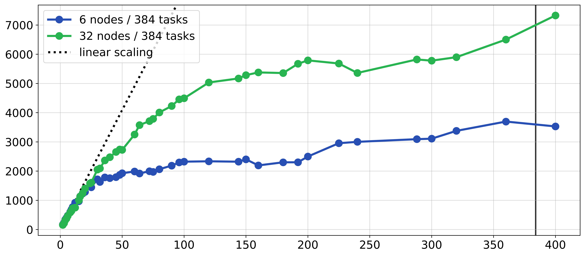
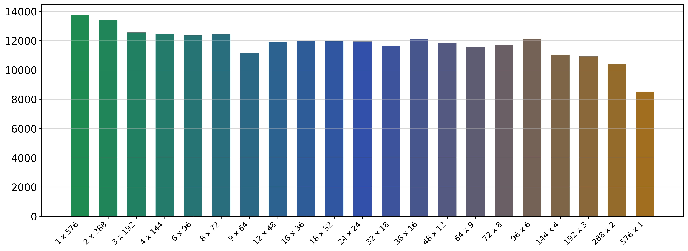

 

# FastFortranBoltzmann 🧮

Distributed D2Q9 LBM fluid solver using Fortran coarrays for inter-node communication on CPU clusters.

The solver supports shear-wave decay, Couette flow, Poiseuille flow, and lid-driven cavity fluid simulation scenarios. The project investigates kernel fusion, memory layouts, domain decomposition, SIMD vectorization, FP precision, Fortran coarrays, MPI pinning and other aspects using a Fortran 2018 implementation. Comprehensive performance benchmarks for solver runs on up to 960 CPU cores across 80 cluster nodes in parallel are provided.

## How to build

Requires Linux, Intel's `ifx` Fortran compiler, Intel MPI, CMake 3.25 or newer, and Ninja. For example, build the `FFB` solver in release mode with double precision and optimizations for your CPU architecture with:

```bash
# e.g. activate a standard Intel oneAPI environment
source /opt/intel/oneapi/setvars.sh

cmake --preset release-fp64-native
cmake --build --preset release-fp64-native --target FFB
```

Choose a build preset from [CMakePresets.json](CMakePresets.json) using the table below, and use the same preset in both CMake commands:

| Build | Single precision | Double precision |
|---|---|---|
| Debug (`-O0`) | `debug-fp32` | `debug-fp64` |
| Release (`-O3`) | `release-fp32` | `release-fp64` |
| Release, native CPU (`-O3 -march=native`) | `release-fp32-native` | `release-fp64-native` |

## How to run

For example, run one simulation on 8 coarray images in a 2 × 4 decomposition with MPI processes pinned to cores. This prints the hardware and simulation setup, live progress, and a final timing and throughput summary, and writes run metadata to `output/EXPORT_NUM/config.json`:

```bash
I_MPI_PIN=1 I_MPI_PIN_DOMAIN=core I_MPI_PIN_ORDER=spread \
    I_X=2 I_Y=4 FOR_COARRAY_NUM_IMAGES=8 \
    ./build/release-fp64-native/bin/FFB
```

| Variable | Meaning | Range | Required |
|---|---|---|---|
| `FOR_COARRAY_NUM_IMAGES` | Total number of coarray images | Positive integer equal to `I_X × I_Y` | Yes |
| `I_X`, `I_Y` | Number of subdomains along the x-axis and y-axis | Positive divisors of `N_X` and `N_Y` | Yes |
| `I_MPI_PIN` | Enables pinning each image to fixed processor cores | `1` (default), `0` | No |
| `I_MPI_PIN_DOMAIN` | Hardware unit whose cores each image is pinned to | `core`, `socket`, `numa`, `node`, `cache1`, or [other forms](https://www.intel.com/content/www/us/en/docs/mpi-library/developer-reference-linux/2021-18/interoperability-with-openmp-api.html) | No |
| `I_MPI_PIN_ORDER` | Order in which images are assigned to pinning domains | `compact` (default), `scatter`, `spread`, `bunch` | No |

## How to benchmark

For example, benchmark one configuration with [benchmark_run.py](scripts/benchmark_run.py), or compare several configurations in a predefined list with [benchmark_sweep.py](scripts/benchmark_sweep.py). Both print the median, best, worst, mean, stddev throughput in MLUPS, and a timing breakdown for each configuration:

```bash
# benchmark one configuration, computing statistics over 5 runs
python3 scripts/benchmark_run.py --exe build/release-fp64-native/bin/FFB \
    --runs 5 --images 8 --ix 2 --iy 4 --pin core_spread

# benchmark several configurations in a "custom" config file, computing statistics over 5 runs each
python3 scripts/benchmark_sweep.py --exe build/release-fp64-native/bin/FFB \
    --runs 5 --case custom --skip 0 --pin core_spread
```

| Option | Meaning | Range | Required |
|---|---|---|---|
| `--images`, `--ix`, `--iy` | Image count and subdomains along the x-axis and y-axis for `benchmark_run.py` | Same as `FOR_COARRAY_NUM_IMAGES`, `I_X`, `I_Y` | Yes, for `benchmark_run.py` |
| `--exe` | Path to the solver executable | `build/release-fp64-native/bin/FFB` (default) or any other built solver | No |
| `--runs` | Run repetitions per configuration | Positive integer, `5` (default) | No |
| `--pin` | Pinning preset that sets the `I_MPI_PIN*` variables | `none`, `core_scatter`, `core_spread` (default), `numa_scatter`, `numa_spread` | No |
| `--case` | Sweep of image grids for `benchmark_sweep.py` | `custom` (default) or any sweep listed by `--help` | No |
| `--skip` | Number of image grids `benchmark_sweep.py` skips at the start | Non-negative integer below the sweep length, `0` (default) | No |
| `--timeout` | Time limit per solver run in seconds | Positive integer, `900` (default) | No |
| `--per-host` | Generates a balanced hostfile inside a Slurm allocation | Flag, off (default) | No |

## How to configure

Simulation settings are fixed at compile time in [source/settings.f90](source/settings.f90), so rebuild after changing them (This is not good design, but allows the compiler to optimize as much as possible). The available settings and their default values are:

```fortran
! grid size and duration
integer(int32), parameter :: N_X = 2520               ! lattice cells along the x-axis
integer(int32), parameter :: N_Y = 2520               ! lattice cells along the y-axis
integer(int32), parameter :: N_STEPS = 1000           ! number of simulated timesteps

! simulation mode
integer(int32), parameter :: SIM_MODE = 4             ! 1 = shear-wave decay, 2 = Couette,
                                                      ! 3 = Poiseuille, 4 = lid-driven cavity

! physical parameters in lattice units,
! FP = real32/real64 depending on build preset
real(FP), parameter :: RHO_0 = 1.0_FP                 ! initial density
real(FP), parameter :: OMEGA = 1.1_FP                 ! collision relaxation rate between 0 and 2
real(FP), parameter :: U_MAX = 0.1_FP                 ! shear-wave decay: initial velocity amplitude
real(FP), parameter :: N_SIN = 2.0_FP                 ! shear-wave decay: sine periods along y-axis
real(FP), parameter :: U_WALL = 0.1_FP                ! Couette: velocity of the moving top wall
real(FP), parameter :: U_LID = 0.1_FP                 ! lid-driven cavity: velocity of the moving lid
real(FP), parameter :: RHO_IN = 1.00005_FP            ! Poiseuille: inlet density, greater than RHO_OUT
real(FP), parameter :: RHO_OUT = 0.99995_FP           ! Poiseuille: outlet density

! kernel selection
logical, parameter :: USE_UNROLLED_KERNELS = .true.   ! manually unrolled compute kernels

! field export
logical, parameter :: EXPORT_MACROS = .false.         ! export density and velocity fields
logical, parameter :: EXPORT_ENDPOINT_STATES = .true. ! also export at the initial and final sim states
integer(int32), parameter :: EXPORT_INTERVAL = 10000  ! timesteps between field exports, 0 disables it
character(len=*), parameter :: EXPORT_NUM = "run_000" ! output directory under output/

! console output
logical, parameter :: INTERACTIVE_PROGRESS = .true.   ! update the progress line in place
integer(int32), parameter :: PROGRESS_INTERVAL = 1    ! timesteps between progress updates
```

## Benchmarks

All of the displayed benchmarks ran the lid-driven cavity with FP64 precision on cluster nodes with two Intel Xeon Platinum 8358 CPUs (64 cores per node), built with IntelLLVM 2025.0.4. Each MLUPS value is the median of repeated runs, and the [job summaries](scripts/cluster/) list every measurement with its exact configuration, hardware, commit, and console output.

### Coarray scaling

A 14400 × 14400 grid for 300 timesteps on 48, 64, 80 nodes with 12 Slurm tasks per node, using up to 960 Fortran coarray images:



*X-axis: coarray images. Y-axis: MLUPS. The vertical lines mark the number of allocated Slurm tasks (576, 768, 960).*

### Task distribution

A 14400 × 14400 grid for 300 timesteps, where 384 Slurm tasks are equally distributed over 6 to 48 nodes:



*X-axis: coarray images. Y-axis: MLUPS. The vertical line marks the number of allocated Slurm tasks (384).*

### Bandwidth contention

A 14400 × 14400 grid for 300 timesteps with MPI pinning disabled, where 384 Slurm tasks are equally distributed over 6 or 32 nodes:



*X-axis: coarray images. Y-axis: MLUPS. The vertical line marks the number of allocated Slurm tasks (384).*

### Decomposition shape

A 14400 × 14400 grid for 300 timesteps, where 576 coarray images on 48 nodes split the grid cells in every possible `I_X × I_Y` layout:



*X-axis: `I_X × I_Y` decomposition. Y-axis: MLUPS. The color gradient indicates the decompositions shape from horizontal (green) to squared (blue) to vertical (brown).*

## Features

- 4 simulation scenarios with shared streaming and collision kernels
- Periodic, bounce-back, moving-wall, and pressure-driven boundary conditions
- Two-dimensional domain decomposition and explicit coarray halo exchanges
- Fuzed and unrolled kernels, with checkpoints for earlier optimization stages
- FP32 and FP64 builds, debug checks, and optional native CPU optimizations
- Per-run timing, hardware metadata, and benchmark measurement scripts
- Distributed export of density and velocity fields with run metadata
- Python scripts for plotting exported fields and benchmark results

## Limitations

- Requires Intel `ifx` with distributed coarray runtime and Intel MPI
- Simulation settings are compile-time constants and require a rebuild
- D2Q9 lattice with a single-relaxation-time (BGK) collision model only

## Documentation

- [Simulation settings](source/settings.f90): Grid dimensions, scenario selection, physical parameters, and export options
- [Build presets](CMakePresets.json): FP precision, debug checks, and compiler optimization flags
- [Cluster jobs](scripts/cluster/): Archived Slurm scripts and detailed console outputs
